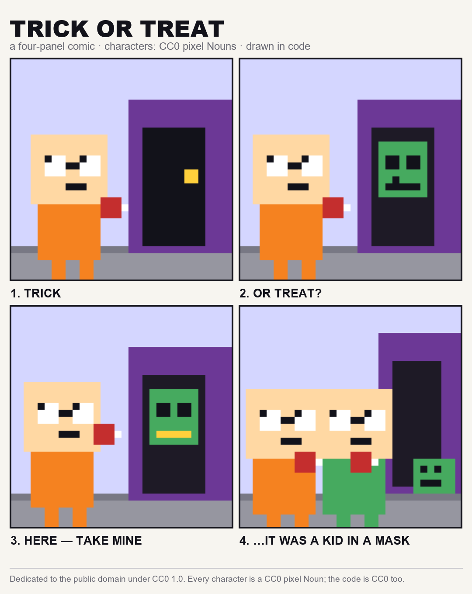

# TRICK OR TREAT — a four-panel CC0 comic



Four panels, one image, starring **pixel Nouns** — the CC0 character collection.

1. **TRICK** — a Noun rings the bell at a purple house.
2. **OR TREAT?** — the door opens on something green with two black eyes.
3. **HERE — TAKE MINE** — the Noun holds out its own candy.
4. **…IT WAS A KID IN A MASK** — the mask is on the ground, and two kids split the candy.

## Why it exists

The comic is the answer to a public bounty: *"Make a Halloween comic in 4 panels, starring characters from any
CC0 NFT collection"*. It is drawn by **code**, not by an image model: `make_comic.py` builds every panel on a
32×32 pixel grid (a Noun is a head, two rectangles of glasses, a body, two legs) and scales it up by nearest
neighbour, so the pixel grid stays honest.

That is the point of the entry: the characters are CC0, the output is CC0, and the **method is reproducible** —
anyone can run `python make_comic.py` and get the same image back.

## Reproduce

```bash
pip install pillow
python make_comic.py          # writes nouns-halloween-4panel.png
```

## Licence

**CC0 1.0 Universal** — the comic, the characters (CC0 pixel Nouns) and the generator code are all dedicated to
the public domain. No attribution required, no permission needed.

## What this is not

It is not an official Nouns comic, and it is not affiliated with Nouns DAO. It uses the CC0 Nouns character
style, which anyone may use.
